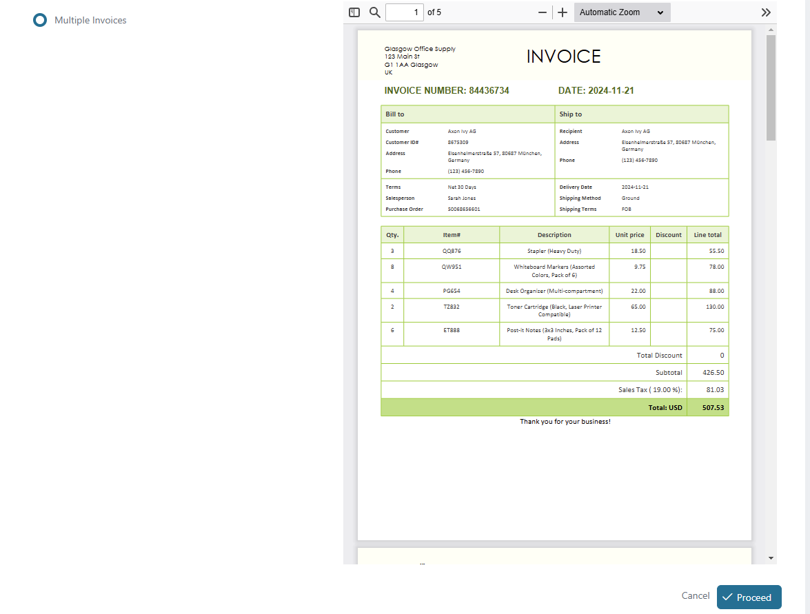
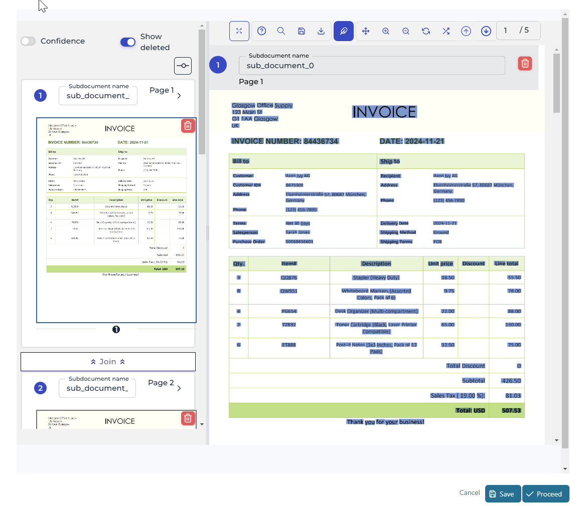
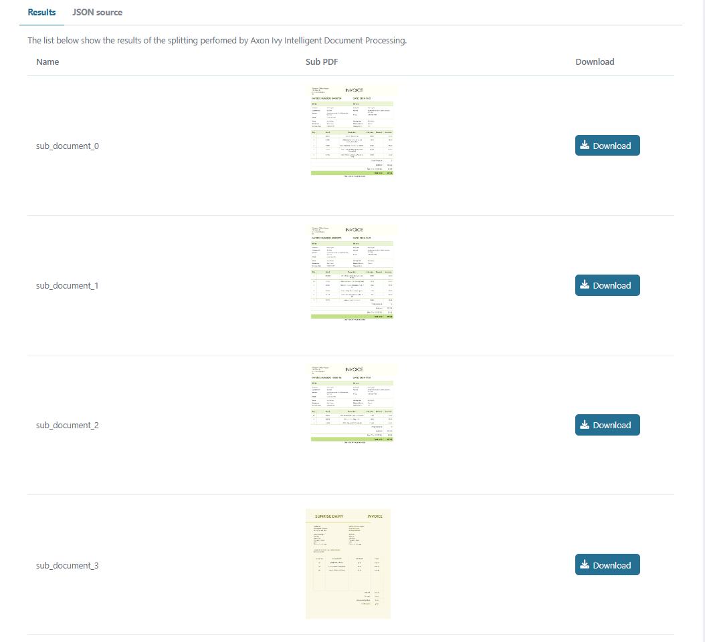
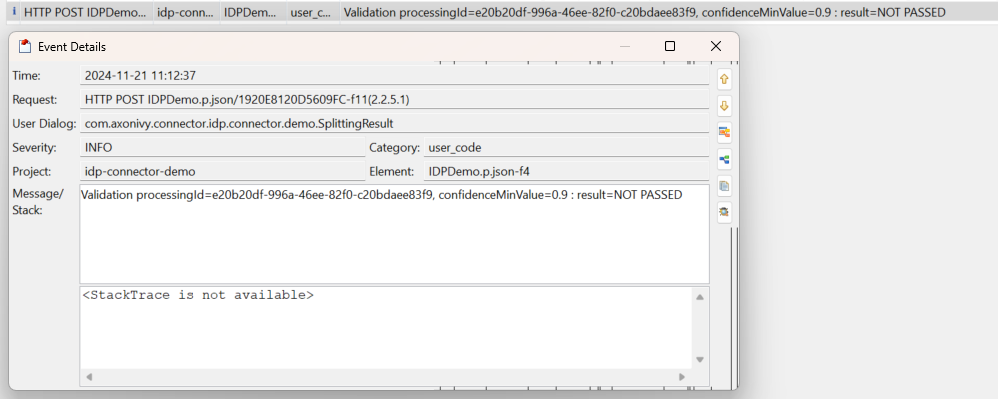
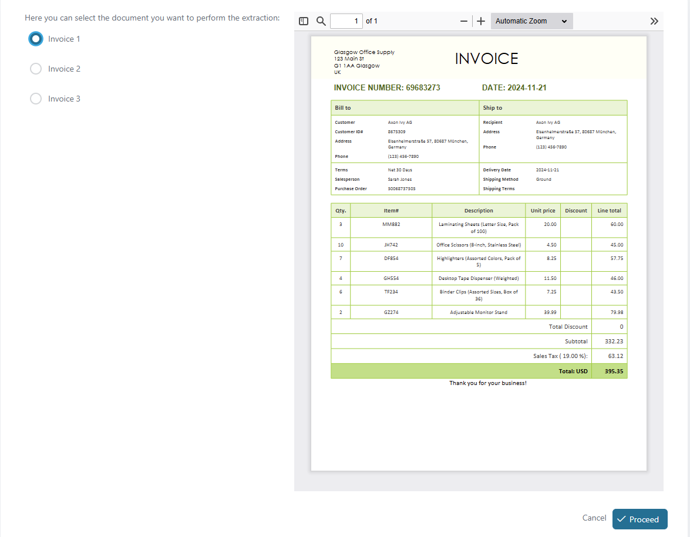
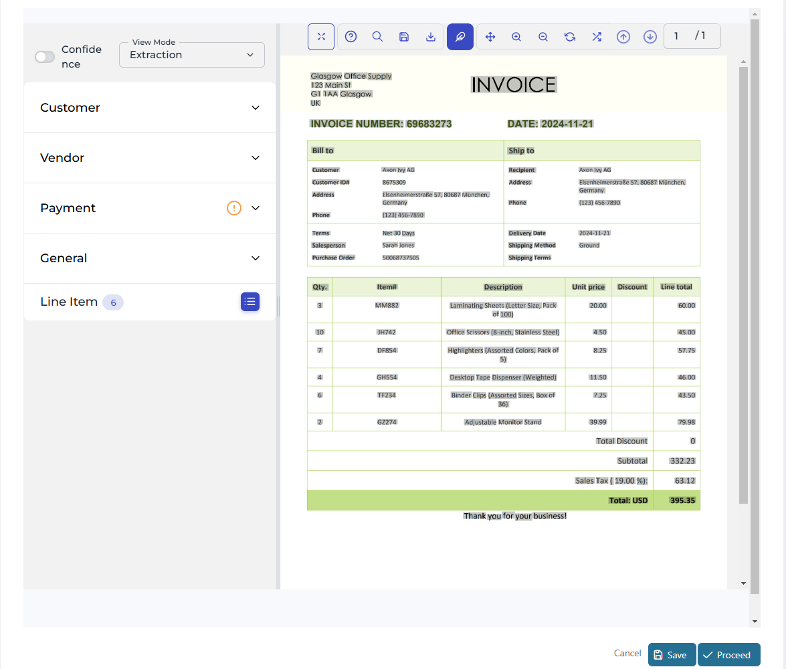
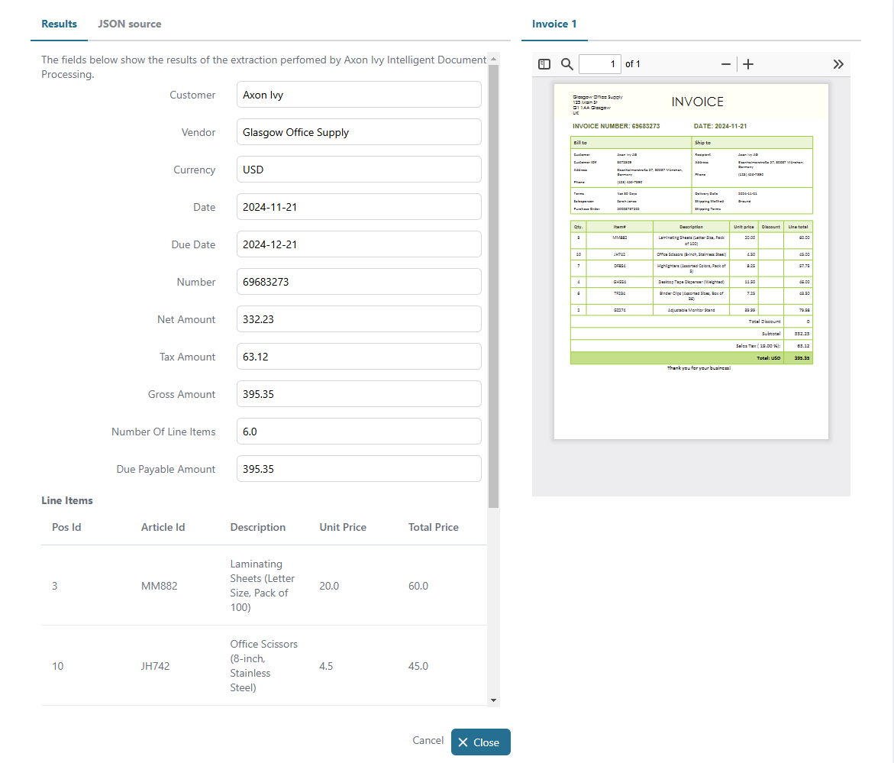
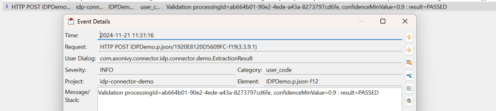

# Axon Ivy IDP Utils

Axon Ivy IDP is an Intelligent Document Processing solution that automates the extraction, classification, and analysis of unstructured data. It streamlines document-intensive processes such as invoice management, claims processing, and customer onboarding using AI-powered OCR, handwriting text recognition (HTR), and machine learning algorithms to increase the accuracy and efficiency in data management. This utility:

* gives you access to the Axon Ivy's capabilities: pre processing, classification and data extraction.
* has a built-in validation of processing results.
* minimizes your integration effort with a standalone UI component.
* is based on REST web service, Axon Ivy UI Component and SubCallable process technologies.

## Demo

### Document Splitting

1. Start 'DocumentSplitting'
   
2. Click 'Process' to review the result of the document splitting service
   
3. Click 'Process' to view the result of document splitting and to download the individual pages
   
4. Check the last log to see the result of the validation function
   

### Extraction

1. Start 'Extraction'
   
2. Select a document from the list, then click 'Process' to review the result of the extraction
   
3. Click 'Process' to view the extraction result
   
4. Check the last log to see the result of the validation function
   

## Setup

Before any interaction between the Axon Ivy Engine and the IDP services can take place, the following steps must be followed:

1. Get a working Axon Ivy IDP `API Key` by contacting support@axonivy.com - this is required to call the REST API services.
2. Override `idpUtils.apiKeySecret` in the demo project as shown in the example below.
3. Set `idpUtils.standAloneUrl` to your IDP standalone UI URL before running the review dialogs.

```
@variables.yaml@
```

## Upgrading connector-based applications

The Ivy 14 projects use the utils naming introduced in version 13.2.1:

* Update Maven dependencies from `com.axonivy.connector.idp:idp-connector` and `idp-connector-demo` to `com.axonivy.utils.idp:idp-utils` and `idp-utils-demo`.
* Update Java, dataclass, process and HTML dialog references to `com.axonivy.utils.idp` and `com.axonivy.utils.idp.demo`, including the `IDPStandaloneUI` component tag.
* Migrate environment overrides and secrets from `idpConnector.*` to `idpUtils.*`, and from `idpConnectorDemo.*` to `idpUtilsDemo.*`. Keep the Ivy 14 `apiUrl` and `apiTimeout` settings; the REST client key remains `IDP`.
* Verify existing cases and tasks in staging before upgrading a deployed application, since their data may refer to the old class names.

For local mock-service verification, explicitly select the processing and validation test classes, which do not match Maven's default test-name patterns. Run from the repository root:

```sh
mvn verify -Dtest=TestIdpDemo,TesProcessingService,TesValidationService -Dsurefire.failIfNoSpecifiedTests=false
```