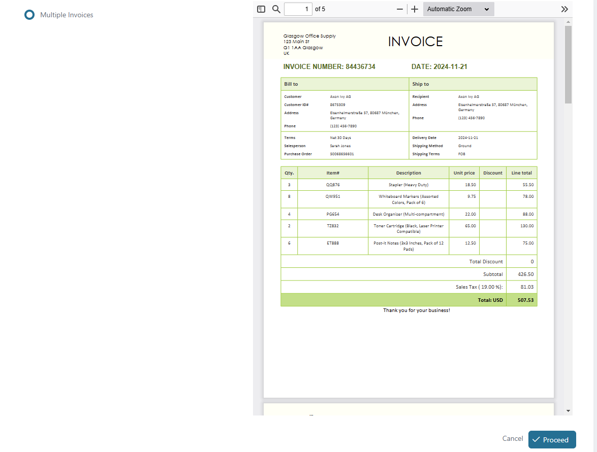
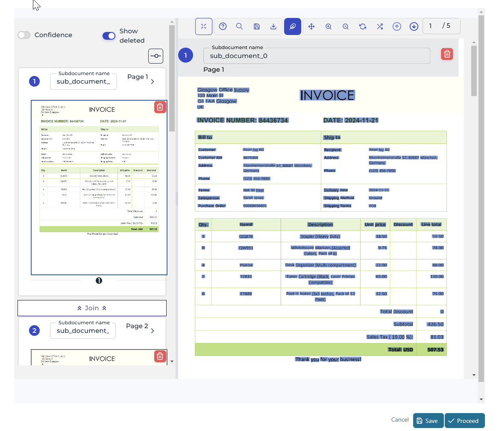
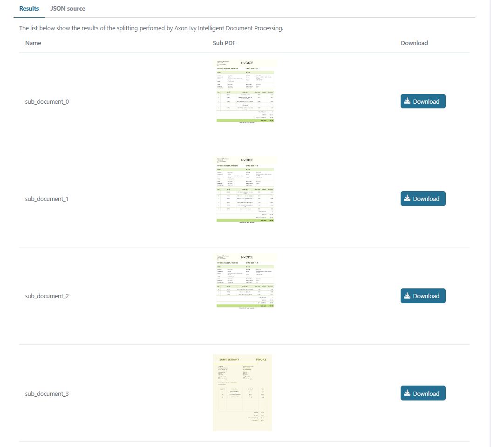
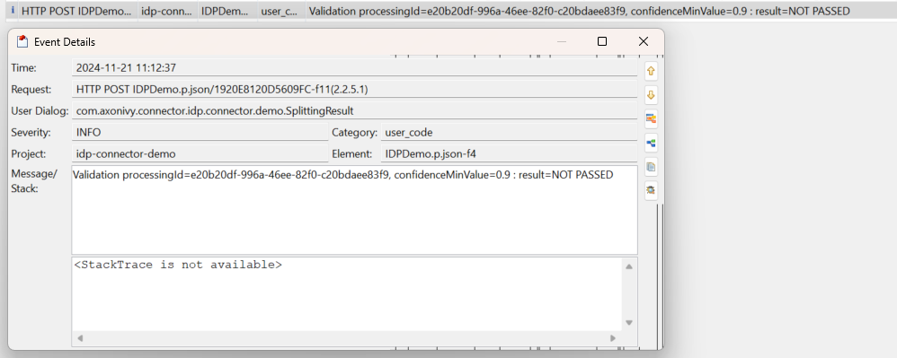
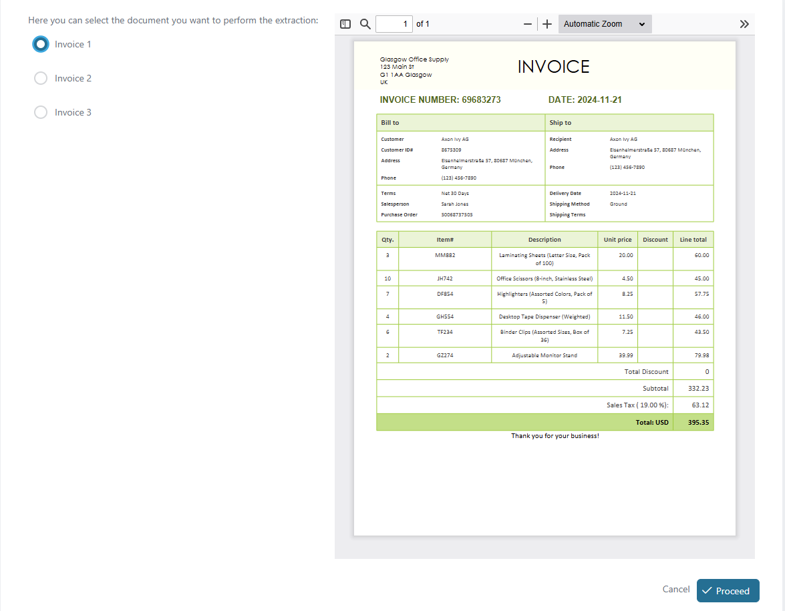
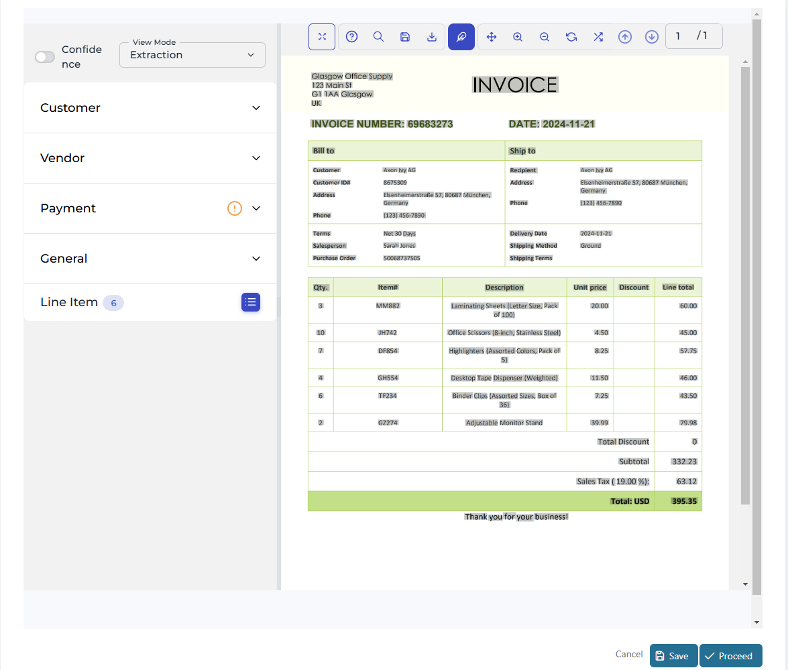
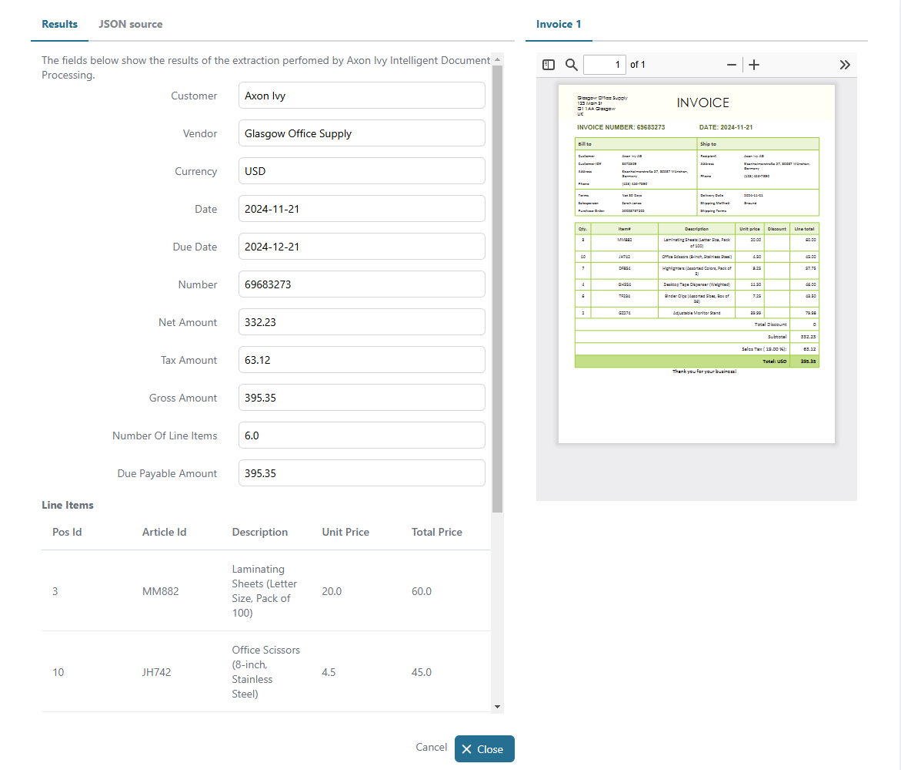
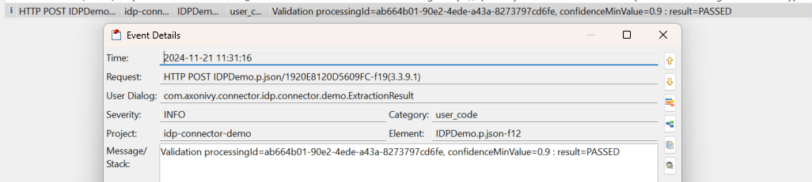

# Axon Ivy IDP Utils

Axon Ivy IDP ist eine Lösung für intelligentes Dokumentenmanagement (Intelligent Document Processing), die die Extraktion, Klassifizierung und Analyse von unstrukturierten Daten automatisiert. Sie optimiert dokumentenintensive Prozesse wie Rechnungsverwaltung, Schadensbearbeitung und Kunden-Onboarding durch den Einsatz von KI-gestützter OCR, Handschrifttext-Erkennung (HTR) und maschinellen Lernalgorithmen, um die Genauigkeit und Effizienz im Datenmanagement zu erhöhen. Diese Utility:
* Ermöglicht Ihnen den Zugriff auf die Fähigkeiten von Axon Ivy: Vorverarbeitung, Klassifizierung und Datenauszug.
* Besitzt eine integrierte Validierung der Verarbeitungsergebnisse.
* Minimiert Ihren Integrationsaufwand mit einer eigenständigen UI-Komponente.
* Basiert auf REST-Webdiensten, der Axon Ivy UI-Komponente und SubCallable-Prozesstechnologien.

## Demo

### Dokumentensplitting

1. Starte 'DocumentSplitting'
   
2. Klicke auf 'Process', um das Ergebnis des Dokumentensplitting-Dienstes zu überprüfen
   
3. Klicke auf 'Process', um das Ergebnis des Dokumentensplittings zu sehen und die einzelnen Seiten herunterzuladen
   
4. Überprüfe das letzte Protokoll, um das Ergebnis der Validierungsfunktion zu sehen
   

### Extraktion

1. Starte 'Extraction'
   
2. Wähle ein Dokument aus der Liste aus und klicke auf 'Process', um das Ergebnis der Extraktion zu überprüfen
   
3. Klicke auf 'Process', um das Ergebnis der Extraktion anzuzeigen
   
4. Überprüfe das letzte Protokoll, um das Ergebnis der Validierungsfunktion zu sehen
   

## Setup

Bevor eine Interaktion zwischen der Axon Ivy Engine und den IDP-Diensten stattfinden kann, müssen die folgenden Schritte durchgeführt werden:

1. Hole einen gültigen Axon Ivy IDP `API Key`, indem du support@axonivy.com kontaktierst – dies ist erforderlich, um die REST-API-Dienste aufzurufen.
2. Überschreibe `idpUtils.apiKeySecret` im Demoprojekt, wie im folgenden Beispiel gezeigt.
3. Setze `idpUtils.standAloneUrl` auf die URL deiner IDP-Standalone-UI, bevor du die Review-Dialoge startest.

```
@variables.yaml@
```

## Bestehende Connector-Anwendungen aktualisieren

Die Ivy-14-Projekte verwenden die mit Version 13.2.1 eingeführten Utils-Namen:

* Aktualisiere Maven-Abhängigkeiten von `com.axonivy.connector.idp:idp-connector` und `idp-connector-demo` auf `com.axonivy.utils.idp:idp-utils` und `idp-utils-demo`.
* Aktualisiere Java-, Datenklassen-, Prozess- und HTML-Dialog-Referenzen auf `com.axonivy.utils.idp` und `com.axonivy.utils.idp.demo`, einschließlich des Komponenten-Tags für `IDPStandaloneUI`.
* Migriere Umgebungsvariablen und Secrets von `idpConnector.*` auf `idpUtils.*` sowie von `idpConnectorDemo.*` auf `idpUtilsDemo.*`. Behalte die Ivy-14-Einstellungen `apiUrl` und `apiTimeout` bei; der REST-Client-Schlüssel bleibt `IDP`.
* Prüfe bestehende Fälle und Aufgaben vor dem Upgrade in einer Staging-Umgebung, da ihre Daten auf die bisherigen Klassennamen verweisen können.

Wähle für lokale Mock-Service-Tests die Prozess- und Validierungstestklassen explizit aus, da ihre Namen nicht den Maven-Standardmustern entsprechen. Führe diesen Befehl im Repository-Stammverzeichnis aus:

```sh
mvn verify -Dtest=TestIdpDemo,TesProcessingService,TesValidationService -Dsurefire.failIfNoSpecifiedTests=false
```
